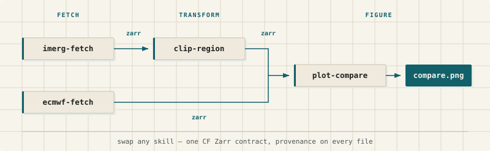

# weather-skills-core

**Note.** This repository is intended for weather-skills developers. If you
are a weather-skills user, call the skills directly in your favorite AI
interface — start at [weather-skills.org](https://weather-skills.org).

Weather skills turn scientific weather-data pipelines into fixed, reviewable
tools that are meant for agentic AI. You write each step in ordinary Python:
fetch a forecast or satellite rainfall field, clip it to a country, convert
units, make a map. Wrapping the function with `@weather_skill` gives it a
command line, shared flags such as `--bbox` and `--start-time`, and a common
Zarr layout so one step's output is the next step's input. Each output file
carries provenance: a record of which skill, version, and arguments produced
it, so someone else can rerun or check the chain. The skill is the script you
checked in; nothing is generated at runtime unless you want it to be.



A pipeline from the [weather-skills](https://github.com/rhiza-research/weather-skills)
collection — weekly CHIRPS rainfall totals over Kenya:

```bash
uv run skills/chirps-fetch/scripts/fetch.py \
  --bbox 5/34/-5/42 --start-time 2026-03-01 --end-time 2026-03-28 -o chirps.zarr
uv run skills/aggregate-temporal/scripts/aggregate.py -i chirps.zarr --period weekly -o weekly.zarr
uv run skills/convert-to-totals/scripts/convert_to_totals.py -i weekly.zarr -o totals.zarr
```

## Writing a skill

```python
from weather_skills_core import Dataset, weather_skill
from weather_skills_core.standard_utils import bbox_subset


@weather_skill(name="my-subset", version="0.1.0")
@weather_skill.argument("-i", "--input", type=Dataset("spatial"), required=True)
@weather_skill.argument("--bbox", required=True)
def my_subset(ds, output, bbox, **kwargs):
    return bbox_subset(ds, bbox)  # the decorator stamps provenance and writes -o


if __name__ == "__main__":
    my_subset()
```

```bash
uv run my_subset.py -i chirps.zarr --bbox 1/36/-2/38 -o nairobi.zarr
```

The decorator builds the CLI from the stacked `argument` calls (same kwargs
as `argparse.add_argument`), opens and checks the input Zarr, parses `--bbox`
into `(N, W, S, E)` floats, adds `-o/--output`, and writes whatever Dataset
you return. The function only holds the domain logic.

The authoring guide covers the rest:

| Question | Read |
| --- | --- |
| How do I lay out and declare a skill? | [`SKILL.md`](docs/weather-skill-authoring/SKILL.md) |
| What should a flag be called, and which flags are parsed for me? | [`CONVENTIONS.md`](docs/weather-skill-authoring/references/CONVENTIONS.md) |
| What dims must a Zarr have, and what is written on output? | [`STANDARD_DATASET.md`](docs/weather-skill-authoring/references/STANDARD_DATASET.md) |
| Rates vs totals, and which unit attrs to stamp? | [`UNITS.md`](docs/weather-skill-authoring/references/UNITS.md) |

## Install

```bash
uv add "weather-skills-core @ git+https://github.com/rhiza-research/weather-skills-core"
```

## Development

This repository is the core library (`weather_skills_core`) and the tools
for writing skills. The skills themselves live in companion collections such
as [weather-skills](https://github.com/rhiza-research/weather-skills).

```bash
uv sync
uv run pytest
uv run ruff format --check .
uv run ruff check .
uv run pre-commit run --all-files
```

Lint a skill, a `skills/` tree, or a repo with `uv run weather-skills-core lint [PATH]`.

Country polygons and Natural Earth region labels live in
`src/weather_skills_core/data/countries.geojson`; `resolve-region` groups
them at runtime, so names like `East Africa` need no sidecar. A few boxes
that are not Natural Earth labels (e.g. `Indian Ocean basin`) are listed in
`region.py`. Rebuild the country file from Natural Earth 110m admin-0 with
`uv run python tools/build_countries.py` (`--help` for the contract).

Pull requests that improve the decorator, the standard dataset contract, or
the docs are welcome. The longer-term aim is an open registry of shared
weather skills on the same dataset and provenance model.
